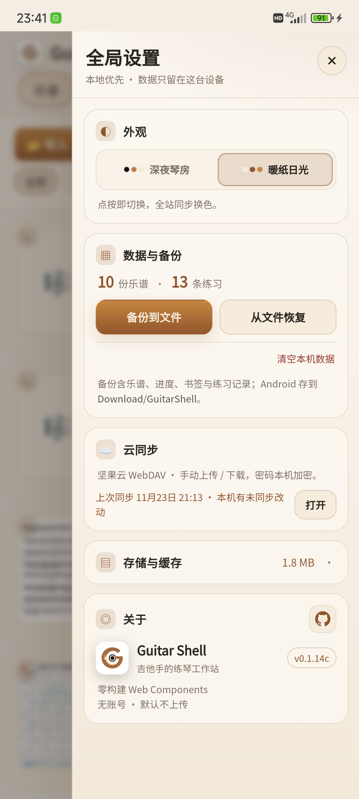
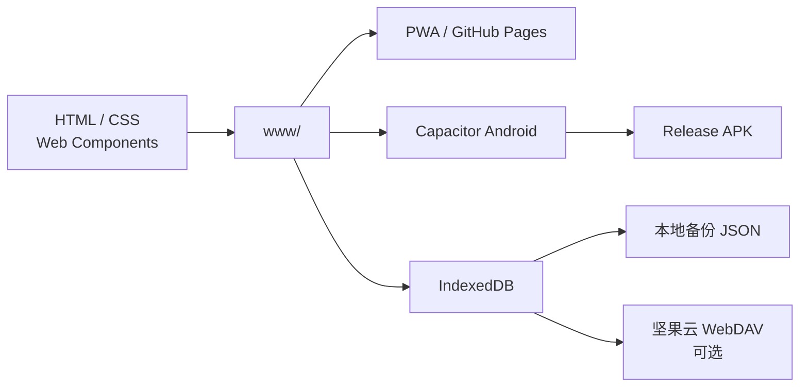

<p align="center">
  
</p>

<h1 align="center">Guitar Shell</h1>

<p align="center">
  <b>吉他手的一站式练琴工作站</b><br>
  乐谱 · 节拍 · 调音 · 练习记录，留在一个本地优先的壳里。
</p>

<p align="center">
  <a href="https://github.com/moanet/GuitarShell/releases/latest">
    
  </a>
  <a href="https://moanet.github.io/GuitarShell/">
    
  </a>
  
  
</p>

Guitar Shell 是一个本地优先的吉他练琴工作站。它把乐谱、节拍器、调音器和练习记录放进同一个界面，不要求账号，默认不把乐谱与练习数据上传云端。

项目使用原生 Web Components、IndexedDB 与 Canvas 构建，网页端零构建即可运行；同一份 `www` 资源通过 Capacitor 打包为 Android 应用。界面提供「复古木质 · 深夜琴房」与「暖纸日光 · 日间模式」两套主题。

## 功能

| 模块 | 已具备 |
| --- | --- |
| 乐谱 | PDF / 图片导入、内容哈希去重、书架与标签、批量管理（批量标签 / 批量删除）、拼音搜索、手势缩放、PDF 页段拆分建卡（起止页缩略图 / 页码选择 / 顺序自动纠正）、页级书签、阅读进度恢复、迷你节拍器、全屏阅读 |
| 节拍器 | 高精度调度、旋钮 / 长按步进 / TAP、8 组拍号 + 自定义拍号、11 种细分（含休止位）、6 种音色、逐拍重音、Swing 1% 步进、变速练习、倒计时、节奏型、音频跟练 / 音频测速、震动反馈、拍点色块 / 计时变速进度、拍号推测、双行练习 HUD |
| 调音器 | 麦克风采集、YIN 基频检测、自动 / 手动选弦、五种预设与自定义调弦、A4 校准收纳、点弦试听标准音、音名与音分显示、音分曲线、调准提示音与震动 |
| 练习记录 | 时长 / BPM / 页码打卡、计时 / 变速自然结束自动记录、累计统计、SVG 趋势、TOP5、页面实时刷新、今日练习卡片（6 套预设 + 2 套自定义背景 / 曲名开关 / 保存相册 / 系统分享） |
| 数据与同步 | IndexedDB 本地存储、完整备份与恢复、坚果云 WebDAV 手动同步、可恢复写入（临时文件 + 校验 + MOVE，MOVE 不可用时 PUT 回退）、非阻塞同步状态与取消 / 重试、同步中退出确认、密码本机加密 |
| 外观 | 深色 / 浅色双主题、全局设置抽屉、Android 系统栏同步、启动动画（总时长约 1 秒） |

## 界面预览

| 乐谱与读谱 | 节拍器 |
| :---: | :---: |
|  |  |
| 乐谱导入、标签筛选、拼音搜索与阅读进度 | 高精度节拍、拍号、细分音色与变速练习 |

| 调音器 | 练习记录 |
| :---: | :---: |
|  |  |
| 预设与自定义调弦、点弦试听、音分仪表与曲线 | 打卡、累计时长、趋势图与最近记录 |

| 日间节拍器 | 全局设置 |
| :---: | :---: |
|  |  |
| 暖纸日光主题下的节拍器与播放控制 | 外观分段切换、数据与备份、云同步与折叠存储 |

## 下载与安装

- **Android 最新版**：前往 [GitHub Releases](https://github.com/moanet/GuitarShell/releases/latest)，在最新 Release 的 Assets 中下载 `GuitarShell-*-release.apk`。
- **安装**：支持 Android 5.1（API 22）及以上。点击 APK 安装；如果系统提示“未知来源”，允许浏览器或文件管理器安装即可，不需要登录账号，也不依赖 Google Play。
- **网页版**：打开 [https://moanet.github.io/GuitarShell/](https://moanet.github.io/GuitarShell/)，可直接使用；桌面浏览器也可以用“安装 / 添加到主屏幕”作为本地应用打开。
- **版本与校验值**：统一以最新 Release 页面为准。


## 快速上手

四个 Tab 依次为 **乐谱 / 节拍器 / 调音器 / 记录**。有乐谱时启动默认进入乐谱；没有乐谱时默认进入节拍器，乐谱空状态也提供「导入第一份乐谱」与「先用节拍器」两个入口。

1. **导入乐谱**：在乐谱书架点「导入」，选择 PDF、图片或拍照。导入后可按标签筛选，也可用谱名或拼音首字母搜索。需要整理时点「管理」多选、全选，批量打标签或批量删除；批量删除会显示数量和谱名摘要，练习记录保留。
2. **开始读谱**：点开谱面后可双指缩放、拖拽，使用页级书签标记位置，点「存进度」记录当前阅读页。再次打开会自动回到上次位置。多曲 PDF 读到某首曲子时，可点工具栏「✂ 拆分」，起止页缩略图可直接点开选页；顺序输反会自动纠正。选中页段生成一张独立新卡，原谱保留，新卡继承标签，可继续存进度、加书签与备份。
3. **跟节拍练习**：在节拍器页设置 BPM、拍号、细分与音色；需要变速练习时开启递增 BPM 与目标小节数。读谱页底部也提供迷你节拍器。需要跟参考音频练习时选择「音频跟练」，只想测速时选择「音频测速」；两者二选一或都不选。跟练会播放音频并自动关闭变速与 Swing，测速只调整 BPM、不播放音频。
4. **给吉他调音**：进入调音器页并允许麦克风权限，选择自动或手动选弦；可调整 A4 基准并试听标准音。
5. **记录本次练习**：在记录页填写时长、BPM 与页码并打卡，趋势面板会汇总近 7 天或近 12 个月的数据。
6. **管理数据**：全局设置抽屉集中提供本地备份、从文件恢复、清空数据、云同步与主题切换。建议在升级或清理浏览器数据前先导出备份；坚果云同步的具体步骤见下一节。

## 坚果云 WebDAV 同步

Guitar Shell 不要求注册账号。云同步使用你自己的坚果云 WebDAV，把乐谱、阅读进度、书签和练习记录打包成一个 JSON 备份，手动上传或下载。它不会在后台自动上传，也不会在多台设备之间自动合并。

### 1. 在坚果云生成应用密码

1. 登录[坚果云网页版](https://www.jianguoyun.com/)。
2. 点右上角账户名，进入「账户信息」→「安全选项」。
3. 在「第三方应用管理」里点「添加应用密码」，名称可以填 `Guitar Shell`，再点「生成密码」。
4. 复制生成的密码。它是专门给第三方应用使用的密码，不是坚果云登录密码；以后可以在同一页面单独撤销。

> 坚果云官方步骤：[第三方应用授权 WebDAV 开启方法](https://help.jianguoyun.com/?cat=4&paged=4)。手机端也可以在坚果云 App 的「设置 → 第三方应用管理」里生成。

### 2. 在应用里填写云同步信息

打开「全局设置」→「云同步」→「打开云同步」，应用会自动切到乐谱页并打开弹窗。按下面的对应关系填写：

| 字段 | 填什么 |
| --- | --- |
| 账号 | 坚果云注册邮箱，不是昵称 |
| 应用密码 | 上一步生成的应用密码，不是登录密码 |
| 路径 | 默认 `GuitarShell/backup.json`；多台设备要保持一致 |
| 同步通道 | 一般留空，让应用自动选择可用通道 |

「同步通道」不是坚果云服务器地址。默认情况下，应用会通过内置通道访问坚果云的 `https://dav.jianguoyun.com/dav/`；只有在你自建了 WebDAV 反向代理时，才需要填写自己的地址，例如 `https://your-proxy.example.com/dav/`，并且要以 `/dav/` 结尾。首次上传时如果 `GuitarShell` 目录不存在，应用会自动补建。自建 Cloudflare Worker 的参考源码见 `proxy/cloudflare-worker.js`，部署时需要在 CORS 中放开 `MOVE`，并把 `Destination` 重写为坚果云上游地址。

### 3. 第一次同步：旧设备上传，新设备覆盖本地

1. 在旧设备填好账号、应用密码和路径，先点「测试连接」。测试只探测同步通道和云端文件是否存在，不会上传数据；看到「连接正常」或「云端已有备份」再继续。
2. 点「📤 上传备份」。如果云端已有备份而本机从未同步过，应用会先提示覆盖风险，确认后才上传。
3. 在新设备填写完全相同的账号、应用密码和路径，同样先「测试连接」。
4. 点「📥 覆盖本地」。应用会用云端备份替换本机的乐谱、阅读进度、书签和练习记录；如果本机已经有数据但从未同步过，会再确认一次。

「覆盖本地」不是合并。两台设备都有新数据时，建议先在各自设备导出本地备份，再决定以哪一边为准。

### 4. 日常使用与冲突提示

- 「上传备份」会用当前设备的数据覆盖云端同一路径下的文件；「覆盖本地」会用云端文件覆盖当前设备。
- 上传前，如果云端在上次同步后又被另一台设备改过，应用会提示云端时间和覆盖风险。
- 下载前，如果本机在上次同步后新增了乐谱、记录或阅读进度，应用会提示这些改动将被丢弃。
- 同步成功后，应用会记住这次同步的云端版本与时间；同一路径才会共用这份同步记录。

### 5. 密码保存与隐私

- 勾选「记住应用密码（仅本机）」后，密码以 AES-GCM 密文保存在本机 IndexedDB，密钥不可导出，也不会写进备份文件；换设备仍要重新填写。
- 页面不是 HTTPS / localhost 时，浏览器不提供加密能力，应用会隐藏「记住密码」，只能每次手填。
- 坚果云里保存的是 JSON 备份文件本身，备份内容没有额外加密；请保护坚果云账号，不要把备份路径公开分享。
- 如果撤销了应用密码，旧密码会立即失效，需要在坚果云重新生成并在应用里更新。

### 6. 常见问题

| 现象 | 先检查 |
| --- | --- |
| 「账号或应用密码错误」 | 账号是否为坚果云注册邮箱；密码是否用了登录密码而非应用密码 |
| 连接超时 / 网络不可达 | 换网络重试；「同步通道」先留空；自建代理地址是否可达且以 `/dav/` 结尾 |
| 「云端没有找到备份文件」 | 路径是否与旧设备完全一致；旧设备是否已经成功上传 |
| 上传或下载超时 | 备份包含乐谱文件，体积可能较大；换 Wi-Fi、减少不用的乐谱后重试 |
| 换机后没有密码 | 「记住密码」只在本机生效；在新设备重新填写应用密码 |

> 坚果云账户有上传 / 下载流量与请求频率限制，具体以账户套餐为准。乐谱较多时，首次上传可能较慢，建议在 Wi-Fi 下进行。

## 项目结构

```text
Guitar Shell
├─ index.html                  网页入口与四 Tab 导航
├─ manifest.json / sw.js       PWA 清单、离线缓存与版本号
├─ css/layout.css              全局布局与双主题 token
├─ js/
│  ├─ main.js                  入口、Tab 切换、组件加载、SW 注册
│  ├─ components/              书架读谱、节拍器、调音器、练习记录、设置、分享预览、背景裁切、通用弹窗
│  ├─ services/                IndexedDB、备份、WebDAV、分享卡、缓存、存储统计、主题、音频、版本
│  ├─ sheet/                   制谱引擎 M1–M3 草案（未接入界面）
│  └─ lib/                     PDF.js、pdf-lib、拼音字典
├─ scripts/                    build-www.mjs、build-apk.mjs、check.mjs
├─ tests/browser/              gs_015–gs_025 浏览器回归
├─ tests/sheet-m*.test.mjs     制谱引擎本地单元测试
├─ android/                    Capacitor Android 壳与原生插件
├─ www/                        构建产物（Git 忽略）
├─ proxy/                      Node / Cloudflare WebDAV 代理
├─ samples/trial-scores/       TXT / ChordPro / Markdown 试用谱例
├─ docs/
│  ├─ screenshots/             实机界面截图
│  ├─ archive/                 历史迭代简报
│  ├─ RELEASE_CHECKLIST.md     发版冒烟、测试矩阵与发布门禁
│  ├─ icon/ · posters/ · qr_code/  品牌与发布素材
│  └─ BRAND.md                 品牌规范
├─ 项目目录结构.txt              项目目录速览
├─ CHANGELOG.md                逐版本迭代记录
├─ CURRENT_TASK.md             当前迭代简报
├─ TASK.md                     长期工程维护手册
└─ package.json · capacitor.config.json
```

### 构建路径



## 本地运行与构建

开发与构建见 [TASK.md §7「构建与发布速查」](TASK.md#7-构建与发布速查)。

## 数据与隐私

- 默认只把乐谱、阅读进度和练习记录保存在本机 IndexedDB。
- 云同步为可选功能，使用用户自己的坚果云 WebDAV；勾选「记住应用密码」时，密码只以密文保存在本机 IndexedDB，详见[坚果云 WebDAV 同步](#坚果云-webdav-同步)。
- 不要求账号，不内置统计上报，不默认上传用户数据。
- 备份文件由用户主动导出，可用于换机或迁移。

## 文档

- [TASK.md](TASK.md)：长期工程维护手册：当前基线、路线、活跃待办、风险、发布门禁与避坑指南。
- [CURRENT_TASK.md](CURRENT_TASK.md)：当前迭代的目标、范围、验收与发布检查。
- [docs/RELEASE_CHECKLIST.md](docs/RELEASE_CHECKLIST.md)：每次发版复用的冒烟清单、测试矩阵与发布门禁。
- [CHANGELOG.md](CHANGELOG.md)：逐版本交付内容、测试与历史决策。
