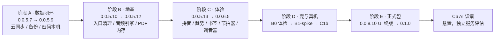

# Guitar Shell 开发任务与进度

> 项目总账：记录长期路线、版本时间线、任务队列、冒烟清单、构建发布、技术债与避坑指南。
> 当前迭代：见 [CURRENT_TASK.md](CURRENT_TASK.md)。
> 已发布版本的完整改动与验收证据：见 [CHANGELOG.md](CHANGELOG.md)。
> 当前基线：线上 Release 为 `0.1.6`；`0.1.5` 已真机验收并推送 `main`，未单独发布；`0.1.6` 已正式发布，APK 已上传并复核。

## 1. 当前阶段

### 1.1 0.1.0 正式包

已完成：


* `namespace` / `applicationId` 切到 `com.guitarshell`；Java 源码从 `cc/ccwu/guitarshell/spike/` 迁到 `com/guitarshell/`。

* `capacitor.config.json` 的 `appId`、`strings.xml` 的 `package_name` / `custom_url_scheme` 同步更换。

* Gradle 版本改为 `versionCode 100` / `versionName "0.1.0"`。

* npm 包名改为 `guitarshell`，版本 `0.1.0`，新增 `apk:release`。

* 网页与 Service Worker 版本同步为 `0.1.0`。

* 新建 release keystore，接入条件式 release signing；签名文件与密码配置均不进入 Git。

* 正式签名 APK 构建通过，包名、版本、v1 /v2 签名与证书指纹均已校验。

* 源码与文档已提交并推送 `main`（`ade4430`）；`v0.1.0` tag 已推送。

* GitHub Release `v0.1.0` 已正式发布，资产 `GuitarShell-0.1.0-release.apk` 已上传；远端下载文件 SHA-256 与本地一致。

* GitHub Pages 已随 `main` 更新到 `0.1.0`。

发布后补验（已完成，2026-11-21）：


* [x] 真机安装 0.1.0，确认与 0.0.8.10 并存安装、启动、权限与备份恢复。

* [x] 旧版设置抽屉导出备份 JSON，新版「从文件恢复」导入，核对乐谱、阅读进度、页级书签与练习记录。

- 验收结论：用户确认无问题；测试机型与系统版本未在本轮记录。

### 1.2 包名与迁移说明


* 0.1.0 与 0.0.8.10 是独立应用，不能覆盖升级。

* 备份包含：乐谱、阅读进度、页级书签、练习记录。

* 备份不包含：WebDAV 密码保险库、主题选择。换机或重装后需要重新设置。

* 备份恢复顺序：先完整校验 dataURL，再清库写入；不要中途清空旧数据。

### 1.3 0.1.1 节拍器练习增强（已发布，历史）

0.1.1 已于 2026-11-21 正式发布，包含节拍器 A/B 批交互与音频能力、音频跟练 / 测速、启动动画 1s。完整改动、验收数据、APK 校验与 Release 信息见 [CHANGELOG.md](CHANGELOG.md) 的 0.1.1 段。

### 1.4 0.1.2 节拍器界面收尾（已发布，2026-11-21）

0.1.2 已完成节拍器布局收尾、拍点色块与计时 / 变速进度、自然结束自动记录、音频拍号推测与设置按钮样式统一；用户真机确认布局与位置合理。release APK 已上传 GitHub Release `v0.1.2`，远端下载 SHA-256 与本地一致。完整改动与验收证据见 [CHANGELOG.md](CHANGELOG.md) 的 0.1.2 段。

### 1.5 0.1.3 数据可靠性（已正式发布，2026-11-22）

0.1.3 聚焦乐谱内容哈希去重、旧库哈希惰性回填、云同步状态提示与 `updatedAt` 改动追踪；不新增功能模块，不改 IndexedDB 版本。浏览器验收已通过：改名同内容不重复入库、同尺寸旧记录回填后可判重、同名同大小不同内容不误判、备份保留 `fileHash/updatedAt`、同步状态文案与路径隔离正确、360/320 无横向溢出。真机已验证覆盖安装与旧数据保留、版本显示 `0.1.3`、导入去重、云同步状态、备份恢复五项，均无误。release APK 已上传 GitHub Release `v0.1.3`，远端下载 SHA-256 与本地一致。范围与验收见 [CURRENT_TASK.md](CURRENT_TASK.md)。

### 1.6 0.1.4 书架管理收口（已发布，2026-11-23）

0.1.4 聚焦书架日常管理：左下角只读标签徽标、左上角编辑入口、编辑弹窗快捷标签（不自动抢焦点）、批量管理与批量标签、统一应用内确认弹窗；追加“记录”页删除不再弹原生确认、云同步检查/打包/上传改为浮动非阻塞状态并自动收起弹窗。批量打标签只做追加/移除，不做整体替换；不做自动云同步和全拼搜索。浏览器 320/360 验收通过；三项追加调整已复验，全屏云同步 loading 不再阻塞界面。APK 已重新构建并校验签名/哈希。范围与验收见 [CURRENT_TASK.md](CURRENT_TASK.md)。

### 1.7 0.1.6 乐谱拆分建卡（已发布）

0.1.6 补读谱器最后一个硬缺口：多曲 PDF 在阅读页选中页段，用 `pdf-lib` 复制页面生成一张独立 PDF 新卡，原谱保留；新卡与旧卡互不依赖，可正常阅读、存进度、加书签、备份与云同步。入口只对 PDF 显示，默认当前阅读页，起止页可改，新卡继承标签、名称可编辑；非法页段禁用建卡，损坏 PDF 只提示不写记录。新增 `js/services/pdf-split.js` 与浏览器回归 `gs_016.py`。`npm run check` 通过 `v0.1.6 / 27 个 JS`；320 / 360 浏览器回归全部通过；release APK 已构建并校验包名、版本、v1/v2 签名与 SHA-256；真机验收通过。已提交 `de69c1b`、推送 `v0.1.6` tag、创建 GitHub Release 并上传 APK。完整证据见 [CHANGELOG.md](CHANGELOG.md) 的 0.1.6 段。

## 2. 演进路线





| 阶段     | 目标                              | 批次                      | 状态                               |
| ------ | ------------------------------- | ----------------------- | -------------------------------- |
| A 数据闭环 | 备份 / 恢复 / 云同步真正可用，数据不丢          | A1～A6                   | 完成，2026-11-18                    |
| B 地基   | 去掉入口噪声、统一音频、控制 PDF 内存           | B3 / B2 / B4            | 完成，0.0.5.10～0.0.5.12             |
| C 体验   | 找谱 / 统计 / 书签 / 节拍器练习能力 / 调音器专业版 | C2 / C3 / C1a / C4 / C5 | 完成，0.0.5.13～0.0.6.5              |
| D 壳与真机 | 壳前体检、宿主预演、屏幕常亮、系统能力             | B0 / B1-spike / C1b     | 完成，0.0.8.1～0.0.8.10              |
| E 正式包  | 正式包名、release 签名、独立安装与数据迁移       | B1-release              | 0.1.0 已正式发布；真机迁移验收完成（2026-11-21） |
| 悬置     | AI 识谱（需后端代理）                    | C6                      | 不进主线                             |

## 3. 功能盘点


| 模块       | 进度  | 已具备                                                                                                          | 主要缺口                               |
| -------- | --- | ------------------------------------------------------------------------------------------------------------ | ---------------------------------- |
| 基础外壳     | 90% | 组件隔离、导航秒切、PWA 离线、图标、版本徽标、全局设置抽屉、一键启动                                                                         | 已完成正式包真机验收与发布；后续仅做维护               |
| 节拍器      | 98% | 高精度调度、旋钮 / 长按步进 / TAP、9 组拍号 + 自定义拍号、11 种细分（含休止位）、6 种音色、逐拍重音、Swing 1% 步进、变速练习、倒计时、节奏型、音频跟练 / 音频测速、震动反馈、双行 HUD | 音频自动节拍点对齐 / 变速拉伸；当前跟练用首拍偏移 + 预节拍对齐 |
| 读谱器      | 92% | 书架 / 标签 AND / 拼音搜索、PDF 虚拟化、手势缩放、进度双轨、页级书签、迷你节拍器同步、全屏与控件渐隐                                                    | 单曲抽取建卡                             |
| 练琴记录     | 92% | 打卡（时长 / BPM / 页码）、累计统计、SVG 趋势、TOP5、实时刷新                                                                      | 按曲目下钻、连续打卡等彩蛋指标                    |
| 调音器      | 95% | 麦克风采集、YIN 基频、指针仪表、自动 / 手动选弦、A4 步进校准、音名 / 音分换算、低音尾音折叠、离页自动关麦、提示音 / 震动反馈、标准音试听、10 秒音分曲线                        | 真机长时稳定性、打壳后的麦克风 / 震动权限             |
| 数据 / 服务层 | 80% | IndexedDB v3、全量备份、WebDAV 多通道、冲突检测、密码本机加密、统一音频引擎、常亮服务、内容哈希去重、同步状态提示 | 云同步自动定时上传（当前手动）                    |
| 壳 / 真机层  | 45% | B1-spike 0.0.7.2 / 0.0.7.3 真机验收；后台 / 锁屏节拍器续响；0.0.8.1 常亮；0.0.8.7 原生备份写盘；0.1.0 release 签名包                     | 长时 Doze 兜底、正式包真机权限稳定性              |

## 4. 版本时间线


| 版本                | 阶段 / 批次                          | 状态                                        |
| ----------------- | -------------------------------- | ----------------------------------------- |
| 0.0.5.6           | 基线：四大模块可用                        | 已推送                                       |
| 0.0.5.7～0.0.5.9   | A 数据闭环：云同步 / 备份 / 密码本机           | 已推送                                       |
| 0.0.5.10～0.0.5.12 | B 地基：入口清理 / 音频引擎 / PDF 内存        | 已推送                                       |
| 0.0.5.13～0.0.5.14 | C 找谱 / 练习趋势                      | 已推送                                       |
| 0.0.5.15～0.0.6.0  | C1a 页级书签 + C4 节拍器满血              | 已验收推送                                     |
| 0.0.6.1～0.0.6.5   | C5 调音器专业版                        | 已验收推送                                     |
| 0.0.7.0           | B0 打壳前体检 + B1-spike 预演包          | 已验收推送                                     |
| 0.0.7.1～0.0.7.2   | B1-spike 真机反馈修复 + 低音弦响度补偿        | 已验收推送                                     |
| 0.0.7.3           | 迷你节拍器步进 / 提示音抗干扰 / 读谱全屏与控件渐隐     | 已验收推送                                     |
| 0.0.8.0           | C1b 首包（原生插件通道未生效）                | 被 0.0.8.1 取代                              |
| 0.0.8.1           | C1b 屏幕常亮（nativePromise 通道修正）     | 已验收推送                                     |
| 0.0.8.3           | UI 复古木质 / 深夜琴房重构（9 色 token 全局换肤） | 已真机验收推送                                   |
| 0.0.8.4           | UI 细节修正第一版（图标未通过，被 0.0.8.5 取代）   | 读谱 / 记录页 / 顶部图标已验收                        |
| 0.0.8.5           | 启动图标缩放 / 全局去蓝色选中框 / 节拍器木鱼音色      | 图标已真机验收推送                                 |
| 0.0.8.6           | 全局设置抽屉 / 读谱翻页热区缩小                | 已真机验收                                     |
| 0.0.8.7           | 数据管理归拢 / 原生备份 / 读谱书架精简 / 齿轮右对齐   | 已真机验收推送                                   |
| 0.0.8.8           | UI 终版：书架标题单行省略 / 附件终稿启动动画        | 已真机验收（启动时长由 0.0.8.9 修正）                   |
| 0.0.8.9           | 启动动画压缩到 1.46 秒 / 蜗牛每次随机起点        | 已真机验收推送                                   |
| 0.0.8.10          | 双主题 UI 终版：暖纸日光 / 复古木质            | 已真机验收推送；GitHub Release 已转正式               |
| 0.1.0             | 正式包名 /release 签名 / 数据迁移          | 已正式发布，GitHub Release `v0.1.0`             |
| 0.1.1             | 节拍器 A/B 批 + 音频跟练 / 测速 + 启动动画 1s  | 已实机验证并正式发布，GitHub Release `v0.1.1`        |
| 0.1.2             | 节拍器界面收尾 / 色块与自动记录 / 拍号推测 / 设置按钮统一 | 已正式发布，GitHub Release `v0.1.2`              |
| 0.1.3             | 数据可靠性：内容哈希去重 / 云同步状态 / updatedAt 改动追踪 | 已正式发布，GitHub Release `v0.1.3`                    |
| 0.1.4             | 书架管理：只读徽标 / 编辑入口 / 快捷标签 / 批量管理 / 统一确认弹窗 / 云同步非阻塞 | 已发布                     |
| 0.1.5             | 交互一致性：批量标签焦点 / 云同步超时、取消、重试 / 回归脚本与 CI | 真机验收通过，未发布                     |
| 0.1.6             | 乐谱拆分建卡：PDF 页段选中、独立 PDF 新卡、标签继承、浏览器回归 | 已正式发布，GitHub Release `v0.1.6` |
| 下一版（版本号待定）        | 待规划                              | 见 [CURRENT\_TASK.md](CURRENT_TASK.md)      |

## 5. 当前进度


* B0 打壳前体检已完成并推送：manifest / SW /toast/ 安全区。

* B1-spike Capacitor 预演包 0.0.7.2 真机验收通过；后台 / 锁屏节拍器可续响。

* 0.0.7.3 体验修复通过：mini 节拍器 +/- 实时变速、提示音抗干扰、读谱全屏与控件渐隐。

* C1b 屏幕常亮通过：`js/services/wakelock.js` 按 reason 引用计数；壳内 `KeepAwake` 原生插件，网页回退 `navigator.wakeLock.request('screen')`；页不可见时释放，回到前台补申请。

* UI 复古木质重构 0.0.8.3 已真机验收并推送：全局 9 色 token，四大模块同步换肤，去掉青蓝 / 亮绿 / 霓虹发光。

* UI 细节修正 0.0.8.5 图标已验收：顶部改用项目自有图标；读谱提示统一为「上次读到的位置」；记录页趋势折叠；Android 图标按 GShell 比例重做；清除蓝色焦点框；节拍器「木鱼」音色。

* 全局设置抽屉 0.0.8.6 已验收：数据备份 / 恢复 / 清空、当前主题、关于；恢复 / 清空后广播数据事件；读谱左右热区缩到 170px 高。

* 数据管理归拢 / 原生备份 0.0.8.7 已验收推送：数据操作全部收进设置抽屉；读谱书架只留导入 / 搜索 / 排序 / 标签 / 书架；Android 备份写入 `Download/GuitarShell/`。

* UI 终版 0.0.8.8 已真机验收：书架标题单行省略；启动动画接入 `splash-preview/splash-final.html`；系统栏同步深色启动层。

* 启动动画提速 0.0.8.9 已验收推送：显示 1.2 秒 + 260ms 淡出，总时长约 1.46 秒；蜗牛随机起点。

* 日间模式 0.0.8.10 已真机验收并作为 UI 终版：深色「复古木质・深夜琴房」与浅色「暖纸日光・日间模式」双主题；主题存 `localStorage` 的 `gs_theme`，Canvas 与 Android 系统栏跟随重绘。

* 0.1.0 正式版：包名 `com.guitarshell`、`versionCode 100` / `versionName 0.1.0`；release keystore 本地生成并接入 Gradle 条件签名；源码提交 `ade4430`，`v0.1.0` tag 与 GitHub Release 已正式发布，APK 下载校验通过。

* Release：`https://github.com/moanet/GuitarShell/releases/tag/v0.1.0`；APK SHA-256：`6FD48F67DEEDE073C12A5BDBB1F04C22D7F603301E797273BC865381C817A1A9`。

* 0.1.0 发布后补验已完成（2026-11-21，用户确认无问题）；随后进入 `0.1.1` 节拍器练习增强。

* `0.1.1` 已正式发布：节拍器 A 批交互、B 批音频 / 节奏型 / 震动、音频跟练与测速二选一、跟练 HUD 双行信息均已完成并通过浏览器验收；启动动画总时长压缩到 `1.00s`；release APK 已完成实机验证并上传 GitHub Release。发布地址：`https://github.com/moanet/GuitarShell/releases/tag/v0.1.1`；APK SHA-256：`C73E31F114F9F19FE6DF19DD70E1E9EA58AE1224AAEBF1304609FF85E2BE66BB`。

* `0.1.2` 已正式发布：节拍器界面收尾、拍点色块、计时 / 变速自动记录、拍号推测与设置按钮样式统一；用户已确认真机布局和位置合理。release APK `4,131,436` 字节，SHA-256 `B0AE1A31A719CFB378DA52EF7BEFEA92454F4358675B0181998A9D98E51B4F90`；`versionCode 102` / `versionName 0.1.2`，v1 / v2 签名通过。发布地址：`https://github.com/moanet/GuitarShell/releases/tag/v0.1.2`；资产已上传，远端 SHA-256 复核一致。当前迭代收尾见 [CURRENT\_TASK.md](CURRENT_TASK.md)。

* `0.1.3` 已正式发布：内容哈希去重、旧库哈希惰性回填、云同步状态提示与 `updatedAt` 改动追踪；release APK `4,136,009` 字节，SHA-256 `43A86823D6ED11B91A527493953FAB48D1D133C13FD9E264E905D910310A5DF1`；`versionCode 103` / `versionName 0.1.3`，v1 / v2 签名通过。发布地址：`https://github.com/moanet/GuitarShell/releases/tag/v0.1.3`。

* `0.1.4` 已发布：左下角只读标签徽标（无标签不显示）、左上角编辑入口、编辑弹窗快捷标签（不自动抢焦点）、书架批量管理 / 追加移除标签 / 批量删除、统一应用内确认弹窗、云下载数量与时间展示 + 先导出本地备份；另修复“记录”页删除仍弹原生确认、云同步检查/上传/下载全屏阻塞并改为上传后自动收起弹窗。浏览器 320/360 回归与真机验收均通过。最终 APK：`4,145,781` 字节，SHA-256 `56CF329C0F9EC0873D47BC179C4FA94D14A937F7167732A608B20BA4C3BD32D7`；`versionCode 104` / `versionName 0.1.4`，v1 / v2 签名通过。Release 与远端资产已复核，GitHub Pages 已部署 `0.1.4`。详见 [CURRENT\_TASK.md](CURRENT_TASK.md)。

* `0.1.5` 真机验收通过，未单独发布：批量标签弹窗不再自动聚焦 / 点快捷标签不抢键盘；云同步超时下调到上传 60s / 下载 30s / 元信息 12s，浮动胶囊支持取消与失败重试；回归脚本入库，新增 `npm run check` 与 GitHub Actions 静态检查，CI 首次运行通过。320 / 360 宽云同步失败胶囊无横向溢出。GitHub Pages 已随 `main` 自动部署 0.1.5 作为开发预览。详见 [CURRENT\_TASK.md](CURRENT_TASK.md)。

* `0.1.6` 已正式发布：PDF 阅读工具栏新增“拆分”，默认当前阅读页，选中页段生成独立 PDF 新卡，原谱保留，新卡继承标签并可继续阅读、存进度、加书签、再次拆分。`npm run check` 通过 `v0.1.6 / 27 个 JS`；`gs_016.py` 在 320 / 360 宽通过。功能提交 `de69c1b`，tag `v0.1.6`；Release ID `455078757`，APK asset ID `781883921`，`4,357,120` 字节，`versionCode 106` / `versionName 0.1.6`，SHA-256 `D397762F6A1A19FEEAA29E8BD79D9B74AE4D49BEEAB61329BC9F4E11F18BC76C`，v1 / v2 签名通过，远端下载复核一致。发布地址：`https://github.com/moanet/GuitarShell/releases/tag/v0.1.6`；GitHub Pages 已部署 0.1.6。

## 6. 任务队列


| #  | 任务                                                | 状态               | 依赖         | 备注                                                   |
| -- | ------------------------------------------------- | ---------------- | ---------- | ---------------------------------------------------- |
| 1  | C5 调音器专业版                                         | 已验收              | `audio.js` | YIN + A4 步进 / 标准音 / 音分曲线 + 离页关麦 + 反馈                 |
| 2  | B0 打壳前体检                                          | 已验收              | C5 验收通过    | manifest / SW /toast/ 安全区                            |
| 3  | B1-spike Capacitor 预演包                            | 0.0.7.3 已验收      | B0         | 后台 / 锁屏节拍器续响                                         |
| 4  | C1b 屏幕常亮                                          | 0.0.8.1 已验收      | B1-spike   | 原生 + Web 双路径，引用计数                                    |
| 4b | UI 复古木质重构                                         | 0.0.8.3 已验收推送    | C1b        | 9 色 token，全局换肤                                       |
| 4c | UI 细节修正                                           | 0.0.8.5 图标已验收    | 4b         | 图标 / 读谱提示 / 记录页 / 木鱼音色                               |
| 4d | 全局设置抽屉                                            | 0.0.8.6 已验收      | 4c         | 设置 + 数据管理 + 主题                                       |
| 4e | 数据管理归拢 / 原生备份                                     | 0.0.8.7 已验收推送    | 4d         | 备份写盘、书架精简                                            |
| 5  | UI 终版                                             | 0.0.8.10 已验收推送   | 4e         | 双主题、单行省略、启动动画                                        |
| 6  | B1-release 正式包                                    | 0.1.0 已发布        | UI 终版      | 包名、签名、迁移、GitHub Release 已完成                          |
| 7  | C6 AI 识谱                                          | 悬置               | 独立后端       | 需要模型 key 与代理，不进主线                                    |
| 8  | 信息架构调整：乐谱优先 / 调音器 Tab / 默认页规则                     | 已纳入 0.1.1        | 无          | 见 §10；代码与截图已同步                                       |
| 9  | README 补充坚果云 WebDAV 同步方法                          | 已纳入 0.1.1        | 无          | 见 README「坚果云 WebDAV 同步」；与现有弹窗字段、路径、冲突检测一致            |
| 10 | 修复调音器标准音快速切换爆音                                    | 已纳入 0.1.1        | 无          | 见 §12；`audio.js` 35ms 淡出，`tuner.js` 不再硬切             |
| 11 | 节拍器 A 批：长按 / 自定义拍号 / 细分 / Swing / 音色 / TAP / 32 拍 | 已纳入 0.1.1        | 无          | 见 CHANGELOG 0.1.1；只改 `metronome.js`、`audio.js`       |
| 12 | 节拍器 B 批 + 音频跟练 / 测速                               | 已纳入 0.1.1        | 11         | 见 CHANGELOG 0.1.1；含节奏型、震动、本地分析、模式门控与双行 HUD           |
| 13 | 启动动画总时长压缩到 1s                                     | 已发布，随 0.1.1 实机验证 | 无          | 见 CHANGELOG 0.1.1；`MainActivity` 800ms 显示 + 200ms 淡出 |
| 14 | 0.1.2：节拍器界面收尾 / 色块 / 拍号推测 / 自动记录                 | 已正式发布          | 13         | GitHub Release `v0.1.2`；详见 [CURRENT\_TASK.md](CURRENT_TASK.md) |
| 15 | 0.1.3：内容哈希去重 / 云同步状态 / updatedAt                  | 已正式发布          | 14         | GitHub Release `v0.1.3`；详见 [CURRENT\_TASK.md](CURRENT_TASK.md)    |
| 16 | 0.1.4：只读徽标 / 编辑入口 / 快捷标签 / 批量管理 / 统一确认 / 云同步非阻塞 | 已发布 | 15         | 批量标签只追加/移除；云同步不再全屏阻塞；详见 [CURRENT\_TASK.md](CURRENT_TASK.md)       |
| 17 | 0.1.5：批量标签焦点 / 云同步超时取消重试 / 回归脚本与 CI | 真机验收通过，未发布 | 16         | 不铺新功能；不单独 Release，随后续跨版本发布；详见 [CURRENT\_TASK.md](CURRENT_TASK.md)       |
| 18 | 0.1.6：PDF 页段拆分建卡 / 独立 PDF / 浏览器回归与 APK | 已正式发布 | 17         | GitHub Release `v0.1.6`；`pdf-lib` 动态加载；原谱保留、新卡独立；详见 [CHANGELOG.md](CHANGELOG.md) 0.1.6 段       |

## 7. 冒烟清单


* [ ] 导入 PDF / 图片，书架出卡。

* [ ] 打开谱，缩放拖拽，存进度，返回书架后重开仍在同一页。

* [ ] 左右热区切歌，目标谱回到上次位置（A / B 不退回第一页）。

* [ ] 打卡后记录页自动刷新并显示页码。

* [ ] 本地备份生成 JSON；清库后从文件恢复，乐谱 / 打卡 / 进度 / 书签完整。

* [ ] 云上传后另一台设备云下载，书架与进度一致。

* [ ] 节拍器与迷你节拍器不同时发声；调音器能识别六弦。

* [ ] 调音页 A4 步进到 432，标准音试听，音分曲线随拨弦起伏；切离页面麦克风立即关闭。

* [ ] 调准时只提示 / 震动一次，开关可关；刷新后 A4 与开关状态保留。

* [ ] 打包后锁屏 / 切后台，节拍与调音不中断。

* [ ] 节拍器播放 / 读谱打开 / 调音监听时屏幕常亮；停止或切走后恢复系统熄屏。

* [x] 0.1.0 与 0.0.8.10 并存安装；旧版备份 JSON 在新版成功恢复（2026-11-21）。

* [x] 音频跟练 / 测速两个勾同一行，二选一或全不选；跟练专属控件只在跟练态可用。

* [x] 跟练开始播放音频并在 HUD 显示文件名 + 速度 / 调性；跟练自动关闭变速与 Swing。

* [x] 测速只调整 BPM，开始不播放音频；全不选时已有音频也不播放。

* [x] 启动动画从首帧到完全消失约 `1.00s`（显示 `800ms` + 淡出 `200ms`）；已随 `0.1.1` release APK 实机验证，`1.00s` 为代码口径，未单独记录秒表实测值。

## 8. 运行、构建与发布

### 本地开发


```
start-dev.bat
```

一条命令同时启动本地静态页与 Node WebDAV 代理，手机连接同一 Wi-Fi 即可访问。

### Android 正式包


```
npm install
npm run apk:release
```

构建前会自动执行 `npm run www` 与 `cap sync android`。产物位于 `android/app/build/outputs/apk/release/app-release.apk`。

### 发布检查


* 同步修改 `js/services/version.js` 与 `sw.js` 的 `APP_VERSION`，否则线上 cache-first 会继续吃旧文件。

* 新文件若被静态 import，必须加入 `sw.js` 的缓存清单。

* `www/` 与 `dist/` 默认不进入 Git；release keystore、`keystore.properties`、`*.jks`、`*.keystore` 必须保持在 `.gitignore` 中。

* GitHub Pages 源为 `main` / root；`index.html` 即入口。

* 每次正式发布同步更新 README 的版本与下载入口，并为 GitHub Release 上传签名 APK。

* 当前版本的范围、验收与发布检查以 [CURRENT\_TASK.md](CURRENT_TASK.md) 为准。

* 对外品牌物料与图标源文件不纳入仓库：当前非商用、不上架应用商店，`docs/BRAND.md`、`docs/posters/`、`docs/icon/` 与 `splash-preview/` 仅保留本地参考，不随版本提交。

## 9. 技术债


* [x] 0.1.3 已新增 `js/services/file-hash.js` 与 `score-dedup.js`：优先 SHA-256，回退 FNV-1a 64；改名后的同一文件不再重复入库，旧记录按同尺寸候选惰性回填哈希。

* [ ] 拼音词典只到首字母，不支持全拼与模糊纠错；次读音可能带来轻微误匹配。

* [ ] 云同步仍为手动触发，未做定时或退出前提醒；0.1.3 已补「上次同步 / 本机未同步改动」状态提示。

* [x] 0.1.6 已新增 `js/services/pdf-split.js`：PDF 页段复制为独立 PDF，原谱保留；入口只对 PDF 显示，非法页段禁用建卡；已真机验收并正式发布。

* [ ] 音频跟练当前使用首拍偏移 + 预节拍对齐，尚未做自动节拍点提取 / 变速拉伸。

* [x] `manifest.json` 的 `start_url` / `scope` 已改为相对 `./`。

* [x] 已补 `CHANGELOG.md`，提交按 `feat:` / `fix:` / `chore:` 规范。

* [x] `sw.js` 的 `base` 死代码已删除，缓存清单与静态 import 对齐。

* [x] APK 内 Service Worker 策略已定：壳内跳过注册，网页端保留。

* [x] 调音器麦克风失败已改为应用内 toast + 状态提示，并复位按钮 / 停止音轨。

## 10. 信息架构调整（已实施，浏览器验收通过）

状态：2026-11-21 用户确认方案；文档先同步，随后完成代码与界面调整。浏览器验收通过，后续已纳入 `0.1.1`。

### 10.1 目标


* 应用内 Tab 名称与顺序固定为 `乐谱 / 节拍器 / 调音器 / 记录`。

* 对外四词口径固定为 `乐谱 · 节拍 · 调音 · 练习记录`。

* 首屏默认规则：


  * 有 1 份及以上乐谱：默认进入 `乐谱`。

  * 0 份乐谱：默认进入 `节拍器`。

  * IndexedDB 读取失败或超时：回退到 `节拍器`，不阻塞启动。

* `乐谱`空状态：


  * 标题：`还没有乐谱`

  * 主入口：`导入第一份乐谱`

  * 次入口：`先用节拍器`

* 搜索 / 筛选无结果仍用另一套空状态：`没有找到符合条件的乐谱`，不显示首次导入入口。

* 不新增独立首页或 Dashboard；`乐谱` Tab 继续承载现有书架与读谱组件。

* Tab 名用 `乐谱` 表示内容入口；进入谱面后的动作仍可称 `读谱`。

### 10.2 已实施内容


* `index.html`：Tab 改为 `乐谱 / 节拍器 / 调音器 / 记录`；四个 `view-section` 按同序排列；初始 `active` 置于 `view-reader`。

* `js/main.js`：新增统一 `setActiveTab()`；启动时用 `getScoreCount()` 判定默认页，1.2 秒超时或读库失败回退节拍器；组件挂载后广播首个激活页；新增 `app-request-tab` 事件，供组件请求切页。

* `js/services/db.js`：新增 `getScoreCount()`，用 `IDBObjectStore.count()` 只取条目数，不读取乐谱 Blob。

* `js/components/sheet-reader.js`：区分零乐谱与搜索无结果；零乐谱空状态显示标题、说明、`导入第一份乐谱` 主按钮、`先用节拍器` 次按钮。

* `css/layout.css`：新增 380px 以下 Tab 紧凑规则，保证 360px 下四枚标签不换行、不横向溢出。

* `CHANGELOG.md`：已在顶部新增「0.1.1 — 节拍器练习增强与启动动画提速（已发布）」，记录信息架构调整、README 云同步文档、调音器切换音修复、节拍器 A/B 批与启动动画提速。

### 10.3 验收标准


* 四个 Tab 顺序准确，360px / 390px 宽度下不换行、不横向溢出。

* 有乐谱启动时落在 `乐谱`；清空乐谱后重启落在 `节拍器`；数据库异常时回退 `节拍器`。

* 零乐谱空状态同时显示 `导入第一份乐谱` 与 `先用节拍器`；前者进入原导入流程，后者直接切到节拍器。

* 搜索无结果不出现首次导入入口。

* 启动默认 `乐谱` 时不请求麦克风、不播放节拍、不残留常亮。

* 主题、设置抽屉、版本徽标与现有数据读写不受影响。

### 10.4 非目标


* 不新增独立首页 / 今日面板。

* 不改 Tab 图标、不动现有视觉 token、不重排四大模块内部布局。

* 不在本轮升版本号或构建 APK。

### 10.5 浏览器验收记录（2026-11-21）


* 390px / 360px 下 Tab 文案与顺序为 `乐谱 / 节拍器 / 调音器 / 记录`，四枚标签单行排列，`scrollWidth` 与视口一致，无横向溢出。

* 零乐谱冷启动：默认 `节拍器`；`乐谱` 空状态显示 `还没有乐谱`、`导入第一份乐谱`、`先用节拍器`。

* 点 `先用节拍器` 可切到 `节拍器`；点 `导入第一份乐谱` 在移动端弹出 `拍照 / 从相册选择 / 选择文件 / 取消` 动作面板。

* 1 份乐谱冷启动：默认 `乐谱`；书架正常显示卡片；首个 `app-tab-changed` 广播为 `view-reader`。

* 搜索无结果：显示 `没有找到符合条件的乐谱`，不出现首次导入入口。

* 默认 `乐谱` 时：`getUserMedia` 调用 0 次，节拍器未运行，调音器未监听，Wake Lock 无持有 reason。

* 模拟 IndexedDB 打开失败：默认回退 `节拍器`，应用仍可启动，控制台记录 `InvalidStateError: simulated`。

* 深色 / 浅色两套主题下空状态、按钮、Tab 均正常；当前版本仍为 `0.1.0`。

## 11. 避坑指南


1. **缓存魔咒**：改代码必须升 `sw.js` 的 `APP_VERSION`，否则 cache-first 永远喂旧文件。

2. **路径刺客**：`pdf.js` 用相对路径本地化加载，手机端浏览器极严格。

3. **音频叠加**：lookahead `setInterval` 退出务必 `clearInterval`；主 / 迷你节拍器互斥交给引擎，不靠事件。

4. **切勿推倒重来**：零构建、原生 Web、拖拽部署是最敏捷的武器；切香肠，享受微小迭代。

5. **进度双轨制**：手动 + 弱自动；不要改成「滚动即写库」—— 那正是旧版永远滞后一个会话的根源。

6. **恢复要原子**：先把 dataURL 全部转 Blob 并校验，全部成功后才清库写入；顺序反过来会中途清空用户数据。

7. **iframe 已死**：PC 端曾用浏览器 PDF 阅读器，它劫持滚动与事件；换回 iframe 会连带摧毁进度、热区与节拍器虚化。

8. **加字段不等于升库版本**：object store 无固定表结构，新字段只需读写时归一化缺省值，不必动 `DB_VERSION`。

9. **DOM 引用别靠闭包**：跨函数修改的 UI 用 `this.shadowRoot.getElementById()` 实时取，避免停止按钮失效。

10. **浮层脱离滚动容器**：热区 / 药丸 / 迷你节拍器挂 `:host` 直属层并 `position:absolute`，左右留 20px+ 安全距离。

11. `!important`**&#x20;会打败内联样式**：需要 JS 控制显隐的元素，样式表不要加 `!important`。

12. **切歌前先存位**：返回书架、左右翻页都必须先 `saveReadingProgress()`。

13. **云同步通道必须能换**：端点绝不写死；排查先点「测试连接」。被静态 import 的服务文件必须进 `ASSETS_TO_CACHE`。

14. **版本号有两处**：`sw.js` 与 `js/services/version.js` 同步改；新文件进缓存清单。

15. **同步点 key 带路径**：`gs_cloud_sync:<path>`，换账号 / 路径不会误判。

16. **密码只进 vault**：AES-GCM、密钥不可导出；不写 localStorage、不进备份、不 `console.log`；局域网 http 自动隐藏保存功能。

17. **音频只走&#x20;**`audio.js`：组件里禁止 `new AudioContext()` / `close()`；发声用 `click()` / `startMetronome()`，麦克风用 `openAnalyser()`。

18. **节拍互斥在引擎里**：`startMetronome()` 自动停上一路并回调 `onStop('preempted')`；组件只在 `preempted` 时复位按钮，避免递归停。

19. **变速练习的 N 有两层含义**：每 N 小节加一档，抵达目标后也保持 N 小节再停；`rampHoldBars` 从 0 起算，避免刚到位就收工。

20. **低音弦尾音会锁到二次谐音**：E2 基频衰减后只剩 164.8Hz，YIN 会当成 D3；检测结果必须先经 `foldToGuitarFundamental()` 按六弦目标折叠，再进中值滤波。正常 E4（329.6Hz）本身是弦目标，不能被折成 A2。

21. **调音器离页必须真关麦**：组件是常驻 DOM、切页只换 `active` 类，不会触发 `disconnectedCallback`；必须监听 `app-tab-changed` 主动 `stopTuner()`。异步 `getUserMedia` 要用 `stopEpoch` 作废旧请求，否则刚点开启就切页会把麦克风偷偷打开。

22. **标准音试听会串进麦克风**：扬声器播参考音时若不暂停检测，麦克风会把 1.2 秒正弦当成琴声、污染音分曲线；用 `isPlayingRef` 跳过检测，结束后清空历史再恢复。

23. **自定义音效是两处开关**：替换内置「叮」要同时改 `audio.js` 的 `CUSTOM_CHIME_URL` 与 `sw.js` 缓存清单，漏一处就会离线回落到合成音或加载失败。

24. **试听停音不能硬切振荡器**：Web Audio 的 `OscillatorNode.stop()` 会在当前相位立即归零，产生截断爆音；停音必须给输出串独立 `GainNode` 做短淡出，再延迟停振荡器。`tone().stop()` 默认 35ms，足够消爆音又听不出拖尾。

## 12. README 云同步与调音器切换音（2026-11-21）

### 12.1 README 坚果云 WebDAV 同步


* 在 README 的「快速上手」之后新增「坚果云 WebDAV 同步」章节，内容包括：


  * 坚果云网页版 / App 里生成第三方应用密码的步骤，明确「不是登录密码」。

  * 应用弹窗字段对应关系：账号 = 坚果云注册邮箱；应用密码 = 第三方应用密码；路径默认 `GuitarShell/backup.json`；同步通道一般留空。

  * 说明「同步通道」不是坚果云服务器地址，只有自建反向代理时才填写，且以 `/dav/` 结尾。

  * 旧设备「上传备份」→ 新设备「覆盖本地」的换机流程。

  * 上传 / 下载冲突提示、手动同步、不会自动合并、密码 AES-GCM 本机保存、备份 JSON 本身不额外加密、流量限制与常见错误。

* 与 `sheet-reader.js` 现有 `cloudModalMask`、`webdav.js` 端点自动切换、`stat` 冲突检测保持一致。

* 坚果云官方参考：`https://help.jianguoyun.com/?cat=4&paged=4`。

### 12.2 调音器标准音快速切换爆音


* 根因：`audio.js` 的 `tone()` 返回的 `stop()` 直接对每个振荡器 `osc.stop()`，波形在任意相位被硬截断，形成类似「pia」的爆音；`tuner.js` 在切换弦、重播标准音时直接调用它。

* 修复：


  * `tone()` 在 `out` GainNode 后串入独立 `fade` GainNode，正常包络不动；`stop(fadeSeconds = 0.035)` 从当前时刻用 35ms 指数淡出到 `0.0001`，延迟到淡出结束后再停振荡器。

  * 停止前尚未起声（`ctx.currentTime < t0`）时，从 `t0` 开始淡出，振荡器仍不会在 `start` 之前被 `stop`。

  * 淡出结束后断开 `out` / `fade`，避免连续试听积累静音节点。

  * `tuner.js` 的 `stopReferenceTone()` 改为 `stop(0.035)`。

* 验收：


  * 无头 Chrome + `ScriptProcessorNode` 采集 `audioEngine.master` 原始 PCM，48kHz。

  * 真实按钮链路 A2→B3→E4 快速切换，A 未放完就切 B、B 未放完就切 e，每次间隔 135–150ms；各停止窗口最大采样跳变与同段正常波形一致，整体最大 `0.0189`。

  * 同一采集链路的 1Hz 峰值硬切对照组最大跳变 `0.1765`，证明采集能测出硬切爆音。

  * 结束后 `isPlayingRef=false`、`refToneHandle=null`，无控制台异常。

* 当时版本仍 `0.1.0`；未升版本、未构建 APK。

## 13. 0.1.1 历史记录（已发布）

0.1.1 已于 2026-11-21 发布，包含节拍器 A/B 批、音频跟练 / 测速、启动动画 1s。完整改动、验收数据、APK 校验与 Release 信息见 [CHANGELOG.md](CHANGELOG.md) 的 `0.1.1` 段；当前迭代见 [CURRENT\_TASK.md](CURRENT_TASK.md)。
